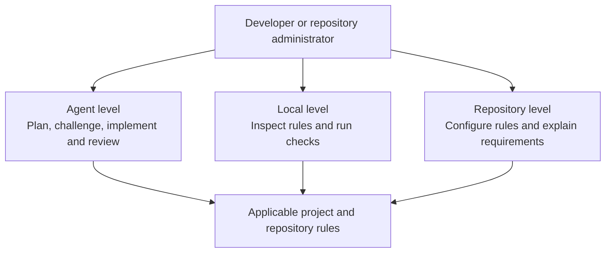
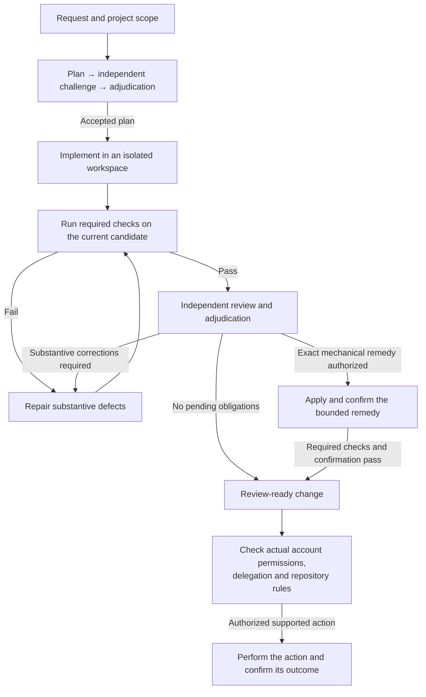

# gitjig

Gitjig helps developers and agents carry software changes from intent to completion with meaningful verification and trustworthy history. It builds on the official Pi coding-agent SDK.

- **Agent:** managed planning, challenge, implementation, independent review and bounded delegation.
- **Local:** rule inspection and checks without an agent workflow.
- **Repository:** configurable rules and guidance for developers and repository administrators.

Gitjig is in early development. Local Git workflows and repository adoption/contribution paths remain incomplete, and governed hosting effects are GitHub-specific. Gitea/GitLab have native inspection, existing-setting updates and explicit protection creation with owned API fixture coverage; live server qualification remains open. Read [Capabilities and limits](docs/capabilities.md) before assigning work.

## How gitjig works

Choose the level that fits your task. Local checks and repository guidance do not require the agent workflow.

An ordinary conversation can investigate and coordinate work. A managed software change follows the path below. Gitjig checks whether each step can proceed; an agent's completion claim does not advance the workflow by itself.

Missing inputs, unresolved decisions, exhausted allowance or unavailable evidence stop progress. A changed plan, requirement or candidate can require earlier steps again. The diagram summarizes the main path; it does not list every recovery transition. Review-ready and landed are separate outcomes. This path does not imply a general hosted PR merge feature; see [Capabilities and limits](docs/capabilities.md).

## Use gitjig

Start with the [User guide](docs/README.md) and [Installation](docs/installation.md). You can run from source or use a prepared bundle. The source/npm route requires Node >=22.19.0 and targets macOS and Linux hosts. Run `bash install.sh` in the checkout to prepare missing prerequisites interactively, then build and register a global `gitjig` command through npm. With compatible Node/npm already installed, `node install.mjs` remains available. See [Requirements](docs/requirements.md) for feature-specific dependencies, known platform limits and tested environments. Prepared offline bundles currently target macOS ARM64.

Opening the UI and managing accounts/settings do not require a model turn or execution engine. Project work needs explicit execution setup. Gitjig owns its settings and credentials; stock Pi settings do not supply defaults.

| Task | Guide |
| --- | --- |
| Configure accounts, models, projects and managed work | [Usage](docs/usage.md) |
| Save execution and Claude Code startup settings | [Startup setup](docs/startup.md) |
| Understand authentication modes and provider limits | [Accounts and providers](docs/providers.md) |
| Run and resume a persistent objective | [Goals](docs/goals.md) |
| Navigate, fork, clone, summarize and copy conversations | [Conversation commands](docs/session-commands.md) |
| Configure keyboard controls | [Keybindings](docs/keybindings.md) |
| Submit project files and inspect captured inputs | [File context](docs/file-context.md) |
| Configure steering and follow-up queues | [Queue preferences](docs/session-preferences.md) |

Press Ctrl+G for the command menu. Shift+Up/Down navigates to an immediate parent/child; split view is optional. Each pane retains its own draft and history. History navigation changes conversation context, not Git checkout state.

Required procedures gate managed actions. Review success, account permissions and explicit delegation are separate conditions. Local/repository operations do not require internal agent planning or review transcripts.

## Contribute to gitjig

Development setup, tests, product requirements and maintenance instructions are separate from the user guide. Contributors should read [CONTRIBUTING.md in the source repository](https://github.com/ilgyu-yi/gitjig/blob/main/CONTRIBUTING.md) and its contributor documentation index.

## License

[MIT](LICENSE). Dependencies retain their own licenses and [third-party notices](THIRD_PARTY_NOTICES.md).
