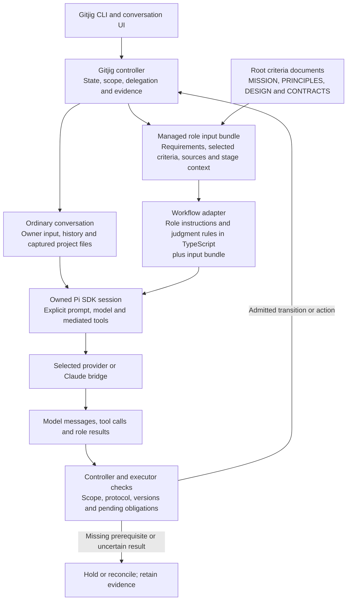

# Contributor documentation

This directory explains how contributors develop and maintain gitjig. Users applying gitjig to another project should start with the [User guide](../docs/README.md).

Read [CONTRIBUTING.md](../CONTRIBUTING.md) for setup, verification selection, engineering lessons, records and dogfooding prerequisites. [AGENTS.md](../AGENTS.md) directs coding agents working on this repository.

| Document | Responsibility |
| --- | --- |
| [Mission](../MISSION.md) | Product purpose, success and boundaries |
| [Principles](../PRINCIPLES.md) | Enduring constraints |
| [Design](../DESIGN.md) | Integrated structure and rationale |
| [Contracts](../CONTRACTS.md) | Observable obligations and acceptance conditions |
| [Runtime ownership and recovery](runtime.md) | Container ownership, original create-refusal evidence and bounded cleanup recovery |
| [Provider maintenance](providers.md) | Internal ownership, SDK compatibility and adapter rationale |
| [Delivery boundaries](delivery.md) | Capability endpoints, composition, recovery and qualification responsibilities |
| [Interaction design](usability.md) | Interaction model, input ownership, readable evidence and verification boundaries |
| [Distribution](distribution.md) | Building and verifying the shipped application |
| [Assignment recovery](assignment-recovery.md) | Cancelled governed-assignment recovery and later owner-direction propagation boundary |
| [Bridge build](../third_party/pi-claude-bridge/BUILD.md) | Maintaining the derivative dependency |

The four normative documents stay at the repository root because the controller also loads them as versioned runtime criteria. Their presence in an installation does not turn them into setup instructions for adopting projects.

## Runtime control and model inputs

Gitjig CLI uses the official Pi SDK, not the stock Pi CLI UI. The controller owns workflow state and action admission. Role sessions propose plans, changes and judgments; they do not grant themselves completion or account authority.

The diagram combines the ordinary conversation and managed-role paths. Only the managed-role path receives the selected product criteria automatically. A model judgment remains fallible; passing controller checks does not prove its semantic correctness.

| Input or control | Implementation |
| --- | --- |
| Product criteria loading | [criteria.ts](../src/controller/criteria.ts): full Mission and Principles; Design D2/D4/D5/D6/D7/D10; Contracts C0/C1/C2/C3/C4/C8/C9/C10 |
| Role instructions and judgment rules | [adapter.ts](../src/workflow/adapter.ts): `runRole`, `roleSemantics` and `implementationCarrySemantics`; these prompts are code, not separate Markdown files |
| Role task prompt | [adapter.ts](../src/workflow/adapter.ts): `promptFor` combines requirements, criteria, stage context, source metadata and selected source text |
| Ordinary conversation instructions | [ordinary.ts](../src/controller/ordinary.ts); investigation instructions also exist in [conversation.ts](../src/controller/conversation.ts) |
| Project document capture | [input-context.ts](../src/controller/input-context.ts): the connected project's root `AGENTS.md`, when present, and explicit `@file` references |
| Goal and independent completion-review instructions | [goals.ts](../src/controller/goals.ts) |
| Session and tool boundary | [session.ts](../src/pi/session.ts): explicit resources; ambient context files, skills and prompt templates are disabled |
| Workflow transitions and evidence checks | [change-core.ts](../src/controller/change-core.ts); external publication has further checks in [publication.ts](../src/controller/publication.ts) |

A reference in a document does not cause recursive loading of linked documents. Contributor instructions remain source-only; they are not runtime role prompts.

## Audience and record boundaries

`docs/` contains maintained product usage, operation and support limits for developers and repository administrators using gitjig. Do not put gitjig contributor test plans, SDK internals, release decisions or development histories there. Source installation is a user task and belongs in the user guide; constructing a release bundle is a contributor task.

Use this directory and CONTRIBUTING for implementation rationale and maintenance procedures. Keep third-party-specific instructions beside that dependency. Legal notices serve users and distributors, so their source/license attribution remains in THIRD_PARTY_NOTICES even when maintenance procedures move here. Keep issue/PR summaries concise; do not add review-round or execution logs to either document tree.
